<div align="center">

# EHR Evidence App

Ask questions about one patient's hospital record and get answers that cite
the records they rest on, with the diagnosis a graph neural network predicts
for the final admission and the recorded concepts behind it.

[](https://github.com/maa2002/ehr-evidence-app/actions/workflows/ci.yml)
[](https://github.com/maa2002/ehr-evidence-app/actions/workflows/release.yml)
[](CHANGELOG.md)
[](LICENSE)
[](docs/environments.md)
[](docs/environments.md)

[](https://physionet.org/content/mimiciv/3.1/)
[](https://github.com/OHDSI/MIMIC)
[](https://huggingface.co/google/medgemma-1.5-4b-it)
[](docs/inherited-gnn.md)
[](docs/interface.md)

</div>

<picture>
  <source media="(prefers-color-scheme: dark)" srcset="docs/images/conversation-dark.png">
  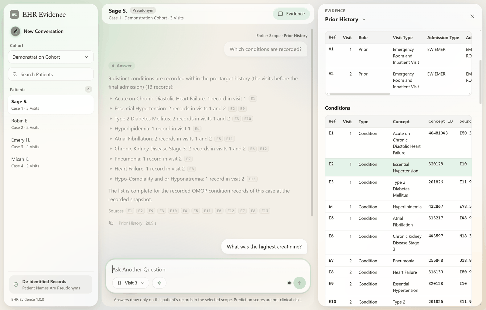
</picture>

> [!NOTE]
> A research prototype for retrospective analysis, not for clinical use. The
> application runs on MIMIC-IV, whose records may not be shared, so every
> screenshot here shows an invented patient: the names, values and dates are
> made up, while the diagnoses, medicines and tests are named from the same
> vocabularies the real records use.

## What It Does

For one patient of [MIMIC-IV 3.1](https://physionet.org/content/mimiciv/3.1/)
mapped to the OMOP Common Data Model, the application:

- Answers questions about the whole record (conditions, medications,
  procedures, laboratory results, microbiology, vital signs, transfers, ICU
  stays, the visits and the person) within a scope the user picks: the visits
  before the final admission, all visits, or one visit;
- Explains a predicted diagnosis: a patient-journey graph neural network
  predicts a diagnosis for the final admission, and the application shows the
  prediction, whether that admission records it, and the recorded concepts its
  score was most sensitive to;
- Cites every fact, with references that open the evidence panel at the record
  each statement rests on;
- Checks every answer before showing it: a release gate checks the answer's
  structure, its references, that the cited records support every statement,
  and its wording, and withholds an answer that fails;
- Refuses rankings and advice, asks back when it cannot read a question, and
  reports "not recorded" as a fact about the scope searched, never as clinical
  absence.

Fixed rules read the questions. MedGemma 1.5 4B, running locally, writes the
answers about conditions and the explanations from a structured view of the
evidence; templates write the other answers, and stand in whenever the gate
withholds the model's text.

## See It Work

<p align="center">
  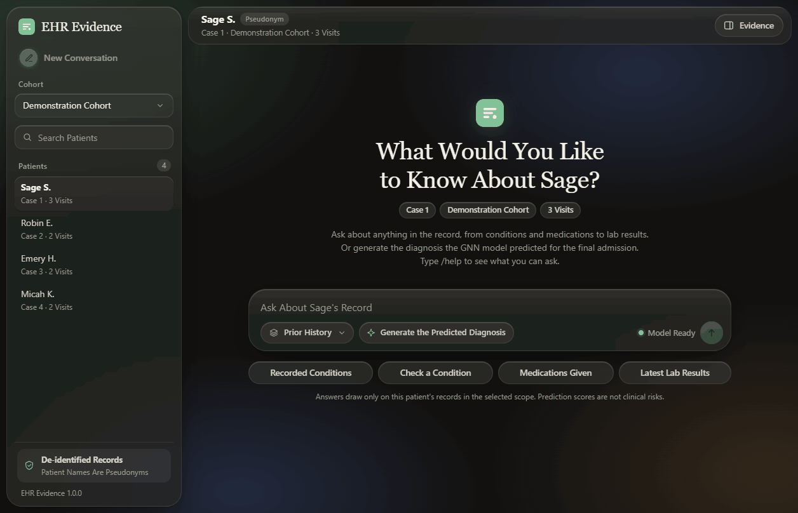
</p>

"Is heart failure recorded?": the answer the model wrote, with one record
matched exactly and one as a more specific concept, and the first reference
opening the evidence at the record it cites.

## A Tour

### The Whole Record

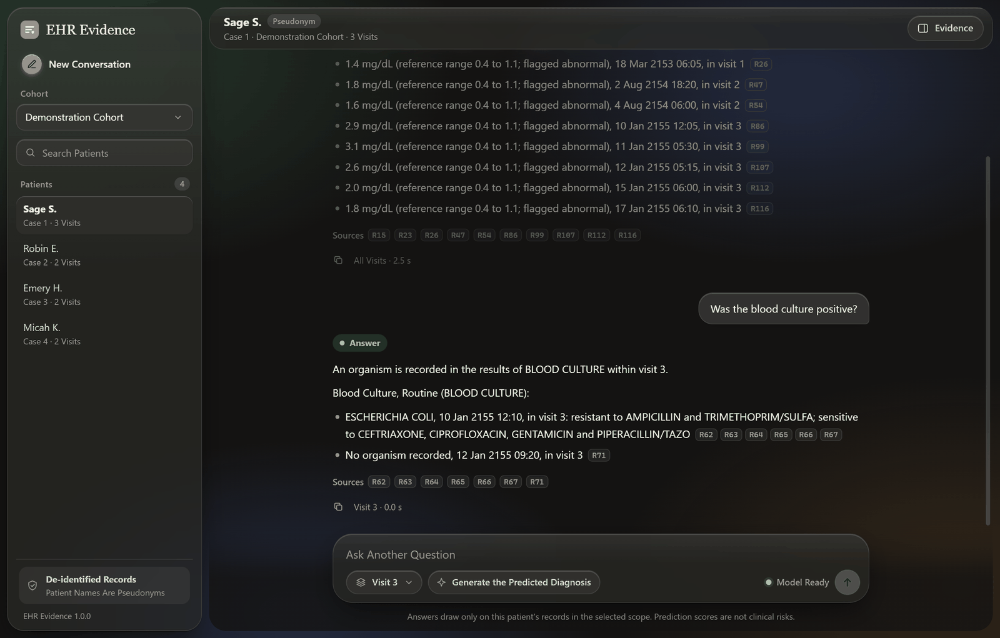

Laboratory results keep their reference ranges and flags, and a culture lists
its organism with every susceptibility. Each line cites its record.

### The Predicted Diagnosis

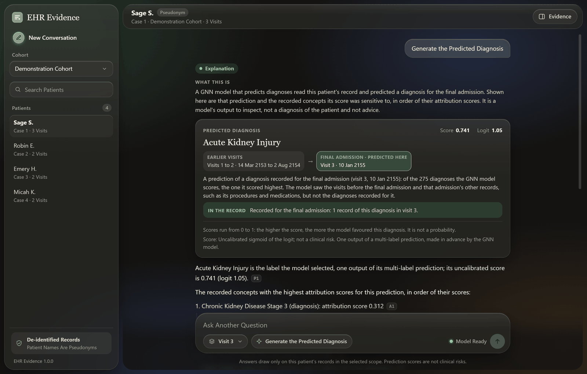

The card shows the model's prediction for the final admission with its
uncalibrated score and the visits it read, and checks whether that admission
records the diagnosis.

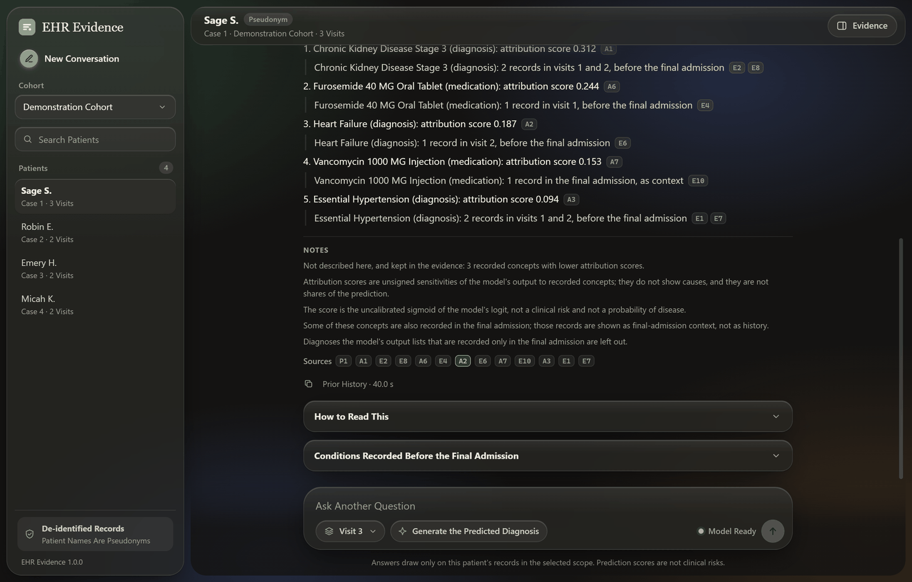

Below it, the explanation lists the recorded concepts the score was most
sensitive to, each with the visits that hold it, and notes what attribution
scores do and do not show.

### Questions It Will Not Answer

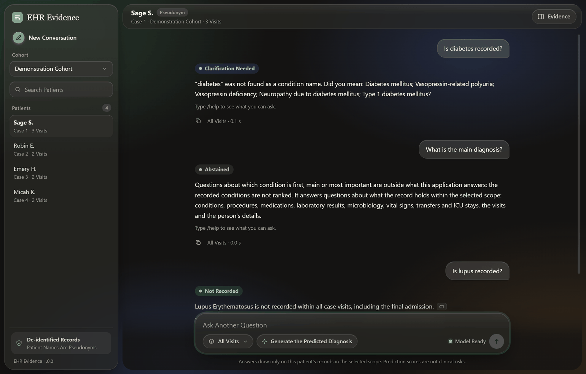

A word that names no condition gets suggestions, a ranking of conditions is
declined because the record does not rank them, and a condition that is not
recorded is reported with the scope it was looked for in.

### Help and Scopes

<table>
  <tr>
    <td width="50%">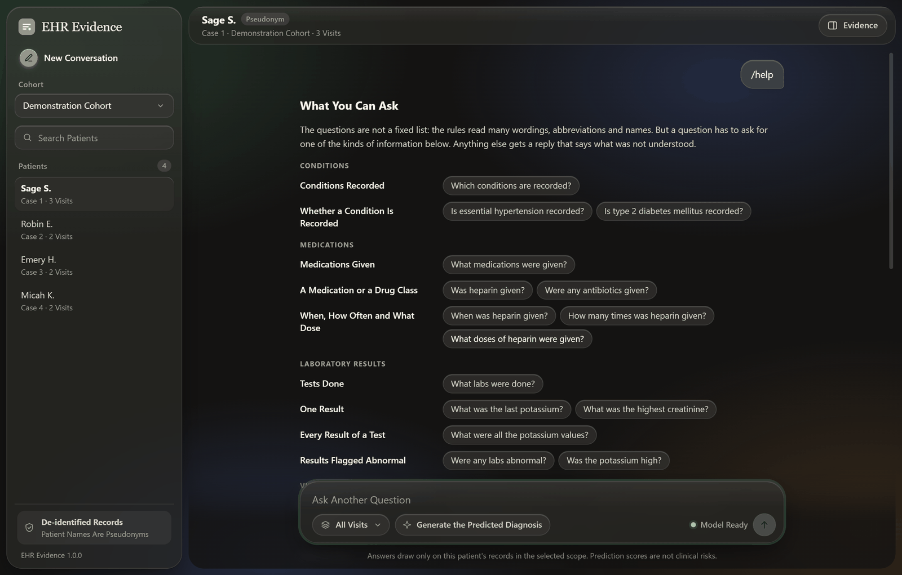</td>
    <td width="50%">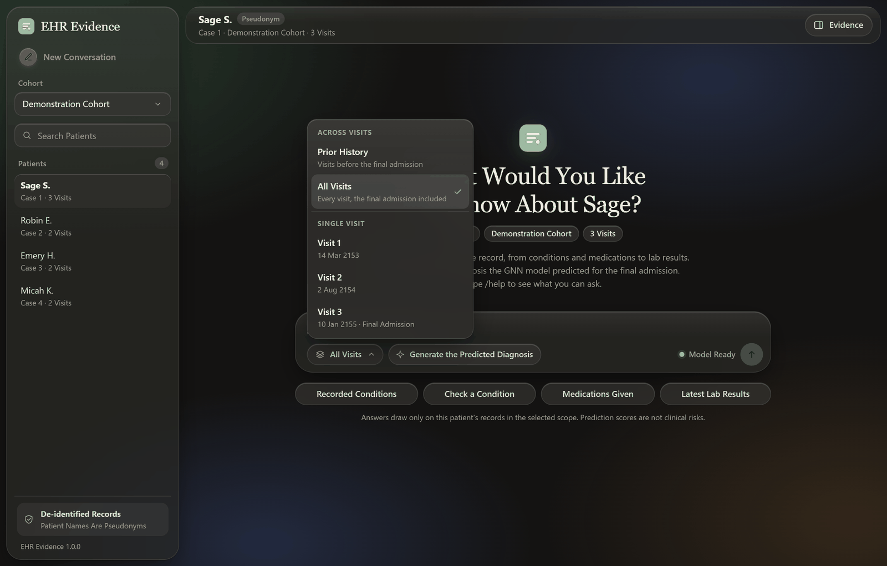</td>
  </tr>
</table>

`/help` lists the kinds of question the rules read, with examples to try, and
every question is answered within the scope chosen in the composer.

### On a Phone + Light and Dark Modes

<table>
  <tr>
    <td width="50%">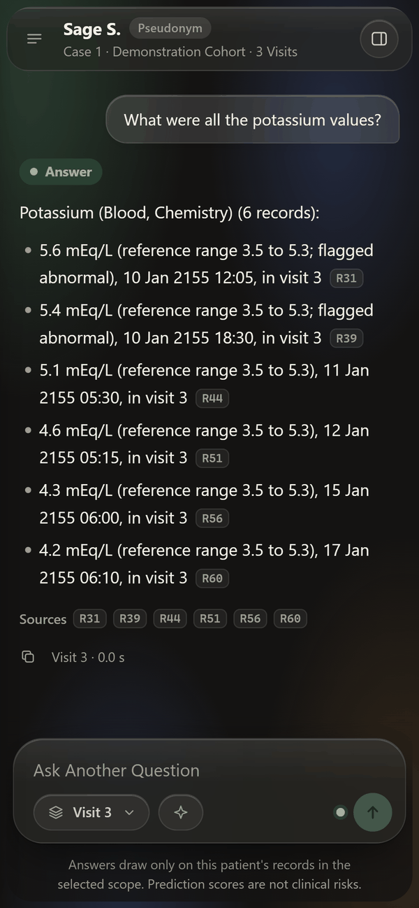</td>
    <td width="50%">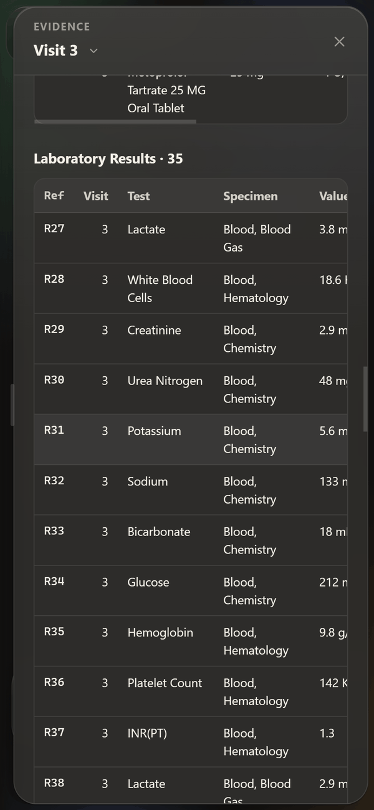</td>
  </tr>
  <tr>
    <td width="50%">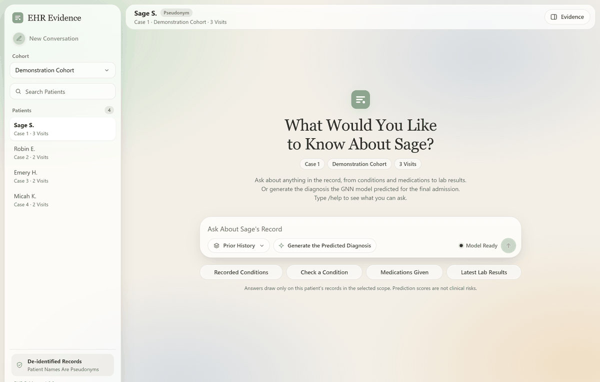</td>
    <td width="50%">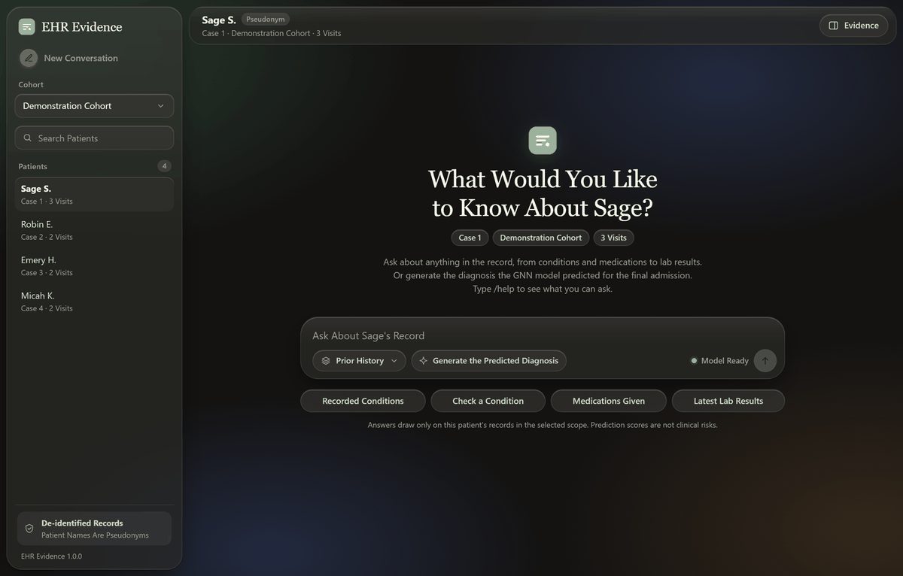</td>
  </tr>
</table>

## How It Works

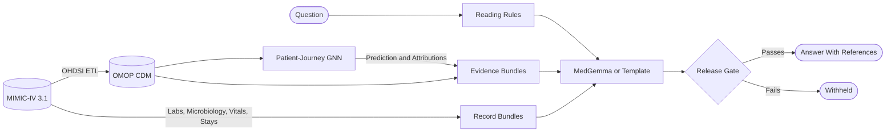

1. Offline builders turn each patient's OMOP records and raw MIMIC-IV tables
   into versioned evidence bundles, one for each scope, with stable references
   (`E1`, `R31`), coverage statements and provenance. The GNN's published
   predictions and attribution scores are linked to the recorded events behind
   them.
2. Fixed rules read a question's task, the item it names and its scope, and
   ask back when they cannot read it.
3. A template, or MedGemma under a schema limited to the request's own
   references, writes the answer as statements whose facts are slots filled
   from the evidence.
4. The release gate checks the structure, the references, the support of every
   statement by its cited records, the preservation of the prediction and the
   wording before anything is shown.
5. A FastAPI service and a single page of plain HTML, CSS and JavaScript run
   on 127.0.0.1, with an optional Cloudflare tunnel behind a secret link for
   sharing.

Patient records never leave the machine: logs, console output and the
experiment tracker carry counts, hashes and finding codes only
([data handling](docs/data-handling.md)).

## Results

The final evaluation ran once, with the version frozen, on 100 persons the GNN
never saw (92 admitted, 1,644 requests). The same model wrote every request
twice: once with no grounding rules, no checks before generation and no
release gate (the baseline), and once as the application does.

| Measure | Baseline | Application | Difference (95% Interval) |
| :--- | :---: | :---: | ---: |
| Unsupported-Claim Rate | 7.1% | 0.0% | -7.1 (-8.2 to -5.9) |
| Claim Support | 98.0% | 100.0% | +2.0 (+1.5 to +2.6) |
| Selective Accuracy | 93.4% | 100.0% | +6.6 (+5.3 to +7.8) |
| Exact Match | 64.5% | 71.5% | +6.9 (+4.4 to +9.5) |
| Correct-Answer Yield | 87.3% | 89.6% | +2.4 (+1.5 to +3.3) |
| Coverage | 93.4% | 89.6% | -3.7 (-5.0 to -2.6) |
| Condition Recall | 57.2% | 53.4% | -3.8 (-7.8 to -0.1) |

Selective accuracy counts only the answers given; correct-answer yield counts
the correct answers among all requests; coverage is the share of requests
answered. The application released no unsupported statement. It pays for that by
withholding some answers the baseline gave, which lowers coverage and recall.
Of 91 explanations, the baseline gave all of them, 17 with an unsupported
statement; the application released 73, every one supported. The full figures,
the prose rubric, the questions typed end to end and the held-out read of
MIMIC-IV-Ext-Instr are in [docs/final-figures.md](docs/final-figures.md).

## Quality

More than 1,600 tests run on invented fixtures. CI runs them on Windows on
every push, together with every module's synthetic mode and the publication
audit, which checks every file and every commit for secrets, patient
identifiers and machine paths.

Mutation tests break correct answers one fact at a time, and every broken
answer must be withheld. On the development case sets, all 24,770 mutants of
condition answers and explanations (65 kinds of error) and all 30,921 mutants
of answers about the whole record are caught. On the invented fixtures, as CI
runs it:

```text
> python -m ehr_evidence_app.validation.mutations
originals released unchanged                 18 of 18
absence_worded_as_record                     detected 4 of 4
absent_reference                             detected 10 of 10
...
mutants detected                             584 of 584 in 64 classes
RESULT: PASS
```

Checks on real data print aggregate counts only, as the condition suite does
on the development case set:

```text
> python -m ehr_evidence_app.qa.suite --operator-real --case-set dev-30-v1
questions                                    1892
correct                                      1892 (100.0%)
```

## Run the Demo

The demo serves invented patients with a scripted model, so it needs no data,
GPU or credentials, only Windows and Python 3.12.

```powershell
git clone https://github.com/maa2002/ehr-evidence-app.git
cd ehr-evidence-app
py -3.12 -m venv .venv
.venv\Scripts\python -m pip install --require-hashes --no-deps -r requirements\app.lock.txt
$env:PYTHONPATH = "$PWD\src"
.venv\Scripts\python -m ehr_evidence_app.api.launch
```

Then open <http://127.0.0.1:8501/>; Ctrl+C stops it. The tests run with
`.venv\Scripts\python -m pytest -q`.

## Documentation

| Document | Contents |
| :--- | ---: |
| [Architecture](docs/architecture.md) | Purpose, Data Flow, Packages, Configuration, Design Rules |
| [Data Handling](docs/data-handling.md) | Storage Layout, Destinations, Path Checks, Publication Audit, Secrets |
| [Source Data](docs/source-data.md) | OMOP Source, Staged Exports, Bounded Pilot Extraction |
| [Inherited GNN](docs/inherited-gnn.md) | Model, Bridge Contract, Identity Mapping, Target and History, Parity, Limitations |
| [Model Outputs](docs/model-outputs.md) | Published Records, Superseded Flags, Admission, Claim Policy |
| [Record Evidence](docs/evidence.md) | Contracts, Evidence Records, Scopes and Coverage, Event Linkage, Bundles |
| [Case Sets](docs/case-sets.md) | Development and Evaluation Case Sets: Registry, Draw Rule, Preparation |
| [Natural-Language QA](docs/qa.md) | Interpretation, Scope, Concept Resolution and Matching, Answers, Suites |
| [Validation](docs/validation.md) | Candidate Contract, Checks, Explanations, Release Gate, Mutation Suite |
| [Generation](docs/generation.md) | Model-Written Candidates: Schema, the Model's View of the Evidence, Prompt, Limits, Fallbacks |
| [API and Interface](docs/interface.md) | The Local API, Its Routes, the Page, Access Checks and the Launcher |
| [Experiment Tracking](docs/experiment-tracking.md) | ClearML Policy and Connection, Controlled Tracking, the Final Figures, Lineage |
| [The Final Evaluation](docs/assessment.md) | Partition, References, Baseline, Paired Runner, Metrics, Prose Rubric, the Freeze |
| [Final Figures](docs/final-figures.md) | The Final Run's Figures and How to Read Them |
| [Acceptance Matrix](docs/acceptance.md) | Each Acceptance Test and Requirement, With What Was Run and Observed |
| [Environments](docs/environments.md) and [Development](docs/development.md) | Environments, Set-Up, Tests, CI, Reconstruction, Releases |
| [Decisions](docs/decisions/) and [Changelog](CHANGELOG.md) | Architecture Decision Records and Release History |

<details>
<summary>Packages In <code>src/ehr_evidence_app</code></summary>

| Package | Responsibility |
| :--- | ---: |
| `storage` | Fixed Storage Roots, Path Checks, Destination Set-Up, Volume Preflight |
| `sources` | OMOP Export Staging; Bounded Read-Only Extraction of MIMIC-IV Tables |
| `gnn` | The Inherited Model's Identity, Validation, Identity Mapping, Parity, Outputs, Provenance, Event Linkage |
| `evidence` | Request and Response Contracts, Evidence Records, Scoped Retrieval, QA, Explanation and Record Bundles |
| `casesets` | Versioned Development and Evaluation Case Sets: Registry and Seeded Selection |
| `qa` | Vocabularies, Question Interpretation, Concept and Scope Resolution, Answers, Suites |
| `validation` | Candidate Contract, Checks, Template Explanation, Release Gate, Mutation Suite |
| `generation` | Model-Written Candidates: Document Schema, the Model's View of the Evidence, Prompt, Adapter, Worker, Measurement |
| `assessment` | The Final Evaluation: Partition, References, Baseline, Paired Runner, Metrics, Rubric, End-to-End Assessment, Freeze |
| `api` and `interface` | The Local API, Its Access Boundary, the Launcher and the Page |
| `tracking` | Tracker Policy, ClearML Connection Checks, Controlled Tracking, Measurements, Lineage |
| `environment` and `quality` | Environment Verification; Publication Audit and Release Checks |

</details>

## Reproducing the Full System

The full system needs credentialed data and a few external pieces. With them,
[docs/environments.md](docs/environments.md) and
[docs/development.md](docs/development.md) describe the set-up, and the
[reconstruction](docs/development.md#reconstruction-and-restart) gives the
order in which a fresh clone was rebuilt and restarted.

| What | Where |
| :--- | ---: |
| PhysioNet Credentialed Access | [physionet.org](https://physionet.org/) |
| MIMIC-IV 3.1, Hospital and ICU Modules | [physionet.org/content/mimiciv/3.1](https://physionet.org/content/mimiciv/3.1/) |
| MIMIC-IV-Ext-Instr 1.0.0, for the Held-Out Reading Test | [physionet.org/content/mimic-iv-ext-instr/1.0.0](https://physionet.org/content/mimic-iv-ext-instr/1.0.0/) |
| MIMIC-IV in the OMOP CDM, in PostgreSQL, Built With the OHDSI MIMIC ETL | [github.com/OHDSI/MIMIC](https://github.com/OHDSI/MIMIC) |
| The OMOP Standardized Vocabularies (CONCEPT, CONCEPT_ANCESTOR and the Rest) | [athena.ohdsi.org](https://athena.ohdsi.org/) |
| The Patient-Journey GNN (`standardized-omop-gnn`), Trained on the Same OMOP Data | [anonymous.4open.science/r/standardized-omop-gnn-7B82](https://anonymous.4open.science/r/standardized-omop-gnn-7B82/) |
| MedGemma 1.5 4B IT | [huggingface.co/google/medgemma-1.5-4b-it](https://huggingface.co/google/medgemma-1.5-4b-it) |
| Python 3.12.8 | |
| GPU Minimum 8 GB | |

The GNN run this project uses is the knowledge-graph variant of the diagnosis
task, replicated with a test macro AUROC of 0.906 over 275 diagnosis labels
([inherited GNN](docs/inherited-gnn.md)).

## Licences

- The code is released under the [MIT licence](LICENSE).
- MIMIC-IV and MIMIC-IV-Ext-Instr are available under the PhysioNet
  Credentialed Health Data License 1.5.0. No data is distributed with this
  repository, and running the full system needs your own credentialed access.
- The OMOP standardized vocabularies come from Athena, each vocabulary under
  its own terms.
- The OHDSI MIMIC ETL is licensed under the Apache License 2.0.
- MedGemma is used under the Health AI Developer Foundations terms of use.
- The patient-journey GNN is used under the terms of its repository.

## Citation

- Johnson, A., Bulgarelli, L., Pollard, T., Gow, B., Moody, B., Horng, S.,
  Celi, L. A., & Mark, R. (2024). MIMIC-IV (version 3.1). PhysioNet.
  <https://doi.org/10.13026/kpb9-mt58>
- Johnson, A. E. W., Bulgarelli, L., Shen, L., et al. (2023). MIMIC-IV, a
  freely accessible electronic health record dataset. *Scientific Data*, 10, 1.
  <https://doi.org/10.1038/s41597-022-01899-x>
- Pollard, T., Moody, B. E., Lehman, L., Gow, B., Fernandes, C., Xie, C.,
  Johnson, A., Mark, R. G., & Heldt, T. (2026). PhysioNet as a global platform
  for biomedical research. *Nature Health*.
  <https://doi.org/10.1038/s44360-026-00096-z>
- Wu, Z., Dadu, A., Nalls, M., Faghri, F., & Sun, J. (2025).
  MIMIC-IV-Ext-Instr: A Dataset of 450K+ EHR-Grounded Instruction-Following
  Examples (version 1.0.0). PhysioNet. <https://doi.org/10.13026/e5bq-pr14>
- Wu, Z., Dadu, A., Nalls, M., Faghri, F., & Sun, J. (2024). Instruction tuning
  large language models to understand electronic health records. *Advances in
  Neural Information Processing Systems 37, Datasets and Benchmarks Track*.
- Hripcsak, G., Duke, J. D., Shah, N. H., et al. (2015). Observational Health
  Data Sciences and Informatics (OHDSI): opportunities for observational
  researchers. *Studies in Health Technology and Informatics*, 216, 574-578.
- Sellergren, A., Kazemzadeh, S., Jaroensri, T., et al. (2025). MedGemma
  technical report. arXiv:2507.05201. <https://arxiv.org/abs/2507.05201>
- The OHDSI MIMIC ETL: <https://github.com/OHDSI/MIMIC>
- The patient-journey GNN: `standardized-omop-gnn`,
  <https://anonymous.4open.science/r/standardized-omop-gnn-7B82/>
